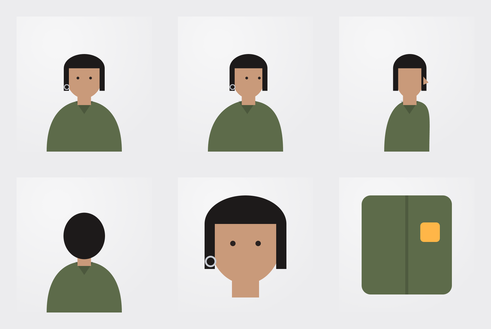

# Reference Packer

**One subject, one sheet.** A small, free tool for getting more consistent AI video on [Higgsfield](https://higgsfield.ai). It packs several reference images (front, three-quarter, profile, back, close-ups) into a single clean reference sheet, checks the sheet against the rules that keep characters and products stable, and writes the prompt that tells your model what the sheet is. It has presets for Seedance, Kling, Wan, Veo and Gemini Omni.

It's the working example for the guide **[Pack Your References: Getting Higher-Quality Seedance Videos on Higgsfield](https://www.sal-anvarov.com/blog/seedance-reference-sheets-higgsfield)**.

**Live:** https://reference-packer.netlify.app



## Why a sheet?

Every video model takes a limited number of references per generation (on Higgsfield, Veo 3.1 takes 3 images, Gemini Omni Flash 6, Seedance 2.0 9 and Kling 4.0 10). Uploading five angles as five files spends five slots on one subject, and each photo brings its own lighting and crop. One sheet per subject:

- costs **one** `@character` / `@product` slot, leaving room for style, motion and audio references;
- shows the subject under **one** lighting setup, at **one** scale, so the only thing that varies between panels is the angle;
- keeps relationships (a product in a hand, a logo on a jacket) intact.

## What the app does

1. **Panels.** Drop photos (or try the sample panels), then reorder or remove them. Everything runs in your browser; nothing is uploaded.
2. **Layout.** Auto or fixed columns, panel size, gutter and a neutral background. Each image is fitted inside an equal cell and never upscaled.
3. **Sheet.** A live preview with a PNG download, plus a linter:
   - 2–9 panels per sheet;
   - at least 2048 px on the long edge;
   - no inputs under 512 px on the short side;
   - similar overall brightness across panels (mismatched light is the fastest route to a face that changes between cuts).
4. **Prompt.** Builds a prompt in the guide's structure for the model you pick: say what the sheet is and that it shows **one** subject, restate the identity anchors, then one action, camera and light.

## Models

| Model | Image references | How the sheet is addressed |
| --- | --- | --- |
| Seedance 2.0 / 2.5 | 9 / 30 (50 references in total on 2.5) | Role tags: `@character`, `@product`, `@style` |
| Kling 4.0 | 10 (plus 5 videos) | `@` tag; describe only the action, the look comes from the reference |
| Kling 3.0 | Elements | Save the sheet as an Element, tag it with `@` in every shot |
| Wan 2.6 | Yes (count not published) | Plain language, no tags |
| Veo 3.1 | 3, Standard model only | Plain language, no tags |
| Gemini Omni Flash | 6, appearance only, with a start frame | Plain language, no tags |

Hailuo, Grok and Kling 2.6 only take a start frame. A sheet used as a start frame animates the grid itself, so make a still from the sheet with an image model first, then animate that still.

Limits are from Higgsfield's model pages and CLI docs as of November 2026 and change often. Presets live in `MODELS` in [`src/sheet.js`](src/sheet.js).

## CLI

The same layout as a Python script, for batch work:

```bash
pip install -r cli/requirements.txt
python cli/make_sheet.py sheet.png front.jpg three_quarter.jpg profile.jpg back.jpg face.jpg detail.jpg
python cli/make_sheet.py sheet.png *.jpg --cols 3 --cell 1024 --gap 48 --bg "#ececee"
```

## Develop

No build step: it's plain HTML, CSS and ES modules.

```bash
python3 -m http.server 8080   # then open http://localhost:8080
npm test                      # layout, linter and prompt tests (node --test)
```

Deployed on Netlify from the repo root (`netlify.toml`), with a strict Content-Security-Policy.

## Author

Built by [Sal Anvarov](https://www.sal-anvarov.com/), a full stack developer in Toronto and founder of the software studio [DEV BY SAL](https://by-sal.dev). Sal presents at a Toronto Meetup on AI topics — how to use different AI techniques to build AI-native software.

Not affiliated with ByteDance or Higgsfield. Reference limits change; check the current caps in the Higgsfield app.

## License

MIT
